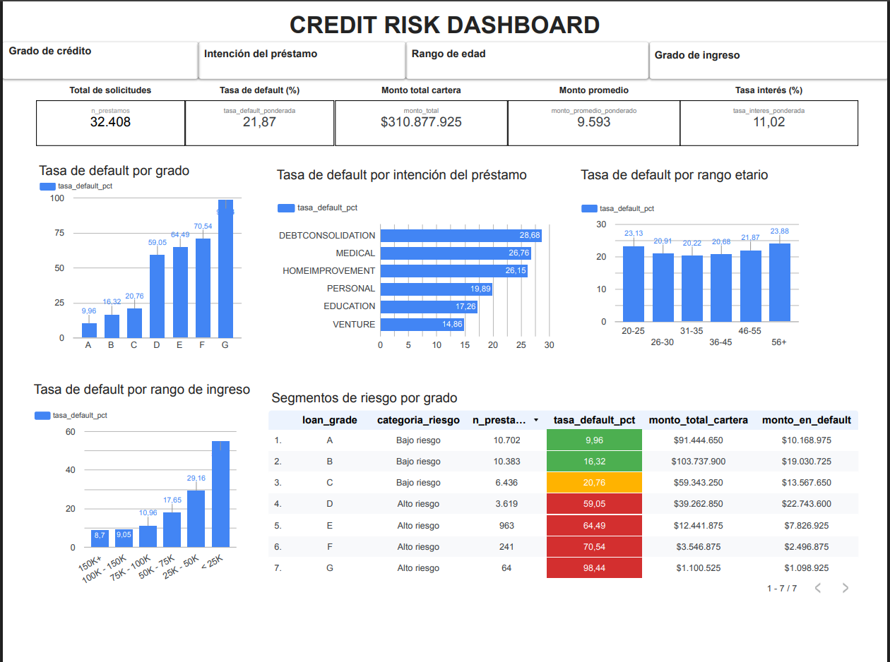

# 📊 Credit Risk Dashboard

Dashboard interactivo de riesgo crediticio construido end-to-end: desde la limpieza de datos en Python hasta la visualización en Looker Studio, pasando por Google BigQuery.

## 🎯 Contexto de negocio

Un banco o entidad financiera recibe solicitudes de crédito y necesita evaluar el riesgo de incumplimiento (default) de cada solicitante, además de monitorear la cartera en su conjunto: ¿qué segmentos concentran más riesgo?, ¿cómo evoluciona la tasa de default por perfil de cliente?

Hoy en día, muchas áreas de riesgo siguen dependiendo de reportes estáticos en Excel que nadie actualiza a tiempo. Este proyecto resuelve ese problema con un dashboard vivo, conectado a un data warehouse en la nube (BigQuery), con filtros dinámicos que permiten explorar el riesgo en tiempo real.

## 📊 Dataset

- **Fuente:** [Kaggle — Credit Risk Dataset](https://www.kaggle.com/datasets/laotse/credit-risk-dataset)
- **Tamaño original:** 32,581 filas × 12 columnas
- **Tamaño final:** 32,408 filas × 13 columnas
- **Variable objetivo:** `loan_status` (0 = no default, 1 = default)
- **Tasa de default global:** 21.87%

## 🔧 Stack tecnológico

| Categoría | Herramienta |
|-----------|-------------|
| Limpieza y EDA | Python (pandas, numpy, matplotlib, seaborn) |
| Data warehouse | Google BigQuery (Sandbox) |
| Dashboard | Looker Studio |
| Control de versiones | Git / GitHub |

## 🏗️ Estructura del proyecto
credit-risk-dashboard/
├── assets/
│ └── dashboard_preview.png # Captura del dashboard
├── data/
│ ├── credit_risk_dataset.csv # CSV crudo (Kaggle)
│ └── credit_risk_clean.csv # CSV limpio (32,408 filas)
├── notebooks/
│ ├── 01_exploracion.ipynb # EDA — 11 auditorías de calidad
│ └── 02_limpieza.ipynb # Limpieza — 7 acciones
├── scripts/
│ └── load_to_bigquery.py # Script de carga a BigQuery
├── sql/
│ └── vistas.sql # 8 vistas SQL de métricas
├── requirements.txt
├── .gitignore
└── README.md

text

## 🔄 Flujo del proyecto
Kaggle (CSV crudo)
↓
Python (EDA + limpieza)
↓
BigQuery (tabla loans + 8 vistas SQL)
↓
Looker Studio (dashboard interactivo)

text

## 📈 Hallazgos clave

### 1. Grado de crédito — el predictor más fuerte

| Grado | Tasa de default |
|-------|-----------------|
| A | 9.96% |
| B | 16.32% |
| C | 20.76% |
| **D** | **59.05%** (punto de quiebre) |
| E | 64.49% |
| F | 70.54% |
| G | 98.44% |

La tasa de default se multiplica por **2.85×** entre el grado C y el D.

### 2. Ingreso — segundo predictor más fuerte

| Rango | Tasa de default |
|-------|-----------------|
| < 25K | 54.61% |
| 25K - 50K | 29.16% |
| 50K - 75K | 17.65% |
| 75K - 100K | 10.96% |
| 100K - 150K | 9.05% |
| 150K+ | 8.70% |

Relación inversa monotónica: a menor ingreso, mayor default.

### 3. La edad NO discrimina riesgo

Todas las edades rondan entre 20% y 24% de default. La variación es de solo 3.7 puntos porcentuales. La edad no es un predictor útil en esta cartera.

### 4. Doble lectura del riesgo

Aunque el grado G tiene la tasa de default más alta (98.44%), el grado D concentra el **mayor monto en default ($22.7M)** por su mayor volumen de préstamos. Un dashboard de riesgo necesita ambas perspectivas: tasa y absoluto.

### 5. Patrón determinista en default previo

Ninguna de las 5,745 personas con default previo recibió grado A o B. El banco aplica un piso de riesgo: si tuviste default, tu grado mínimo es C.

## 🧹 Proceso de limpieza (resumen)

Se auditaron 11 dimensiones de calidad de datos sobre el dataset original:

- **7 dimensiones limpias:** columnas irrelevantes, typos categóricas, tipos de datos, espacios ocultos, formato/estandarización, mezcla de unidades, valores vacíos.
- **4 dimensiones con hallazgos:** nulos (2 columnas, MCAR), duplicados (con sesgo de -10.41 pp en tasa de default), outliers (7 imposibles + 781 corregidos con cap), lógica de negocio (patrón determinista).

Total de filas eliminadas: **173 (0.53%)**. El dataset preserva el **99.47%** de los datos originales.

## 🖥️ Dashboard



🔗 **Link público:** [https://datastudio.google.com/reporting/cde7e133-3793-4c43-b770-7709917c45d1]

**Funcionalidades:**

- **5 KPIs principales:** total de solicitudes, tasa de default, monto total cartera, monto promedio, tasa de interés promedio.
- **4 gráficos de análisis:** por grado de crédito, por rango de ingreso, por rango etario, por intención del préstamo.
- **1 tabla de segmentos:** 7 grados con categoría de riesgo, cantidad, tasa de default y monto en default.
- **4 filtros interactivos:** grado de crédito, rango de edad, rango de ingreso, intención del préstamo. Todos afectan dinámicamente a los KPIs y gráficos.

## 🚀 Cómo reproducir

```bash
# 1. Clonar el repositorio
git clone <url-del-repo>
cd credit-risk-dashboard

# 2. Crear entorno virtual e instalar dependencias
python3 -m venv venv
source venv/bin/activate
pip install -r requirements.txt

# 3. Ejecutar los notebooks en orden
jupyter notebook
# → notebooks/01_exploracion.ipynb
# → notebooks/02_limpieza.ipynb

# 4. En BigQuery: crear el dataset `credit_risk` y ejecutar sql/vistas.sql
# 5. Conectar Looker Studio a las vistas
📝 Aprendizajes técnicos
BigQuery Sandbox: alternativa sin costo para proyectos de portafolio (10 GB almacenamiento + 1 TB consultas/mes, tablas expiran en 60 días).

Campos calculados ponderados: en Looker Studio, promediar promedios sin ponderar distorsiona. Se resuelve con SUM(peso × valor) / SUM(peso).

Verificación post-carga: siempre comparar el conteo de filas del CSV con la tabla en el destino.

Formato condicional: Looker Studio permite reglas o escalas de color para resaltar métricas clave.

La limpieza es iterativa: cada transformación puede crear nuevos problemas (duplicados residuales, NaN en comparaciones, etc.).

👤 Autor
[Mauricio Bustillos] — [https://www.linkedin.com/in/mauriciobustillos/] — [mauriciobustillosmeneses17@gmail.com]
## 📝 Licencia

Este proyecto está bajo la licencia MIT. Ver el archivo [LICENSE](LICENSE) para más detalles.
